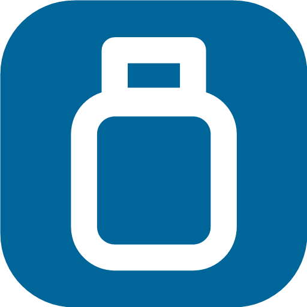
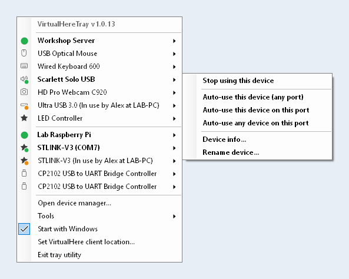
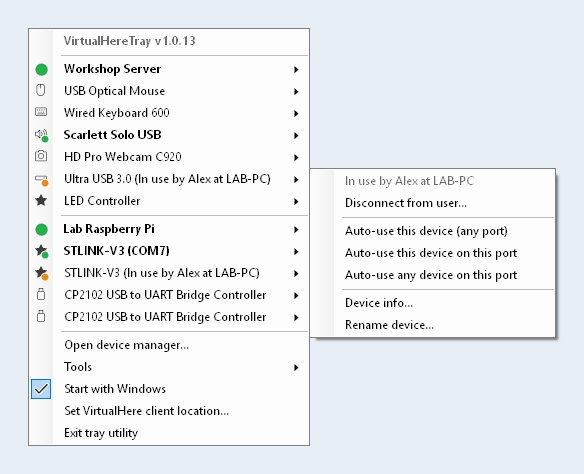
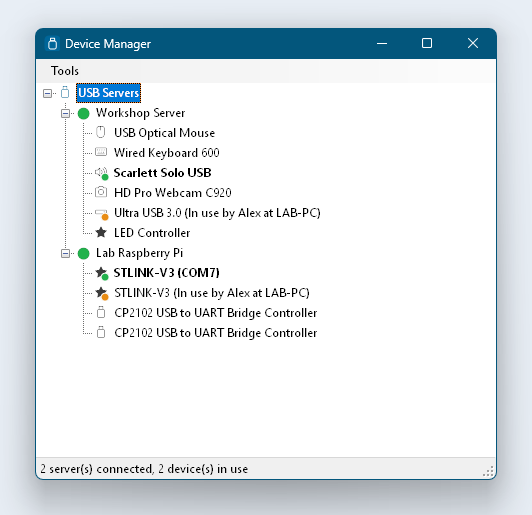
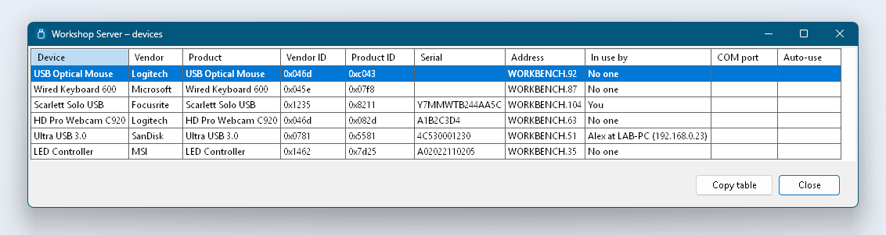

<p align="center">
  
</p>

<h1 align="center">VirtualHereTray</h1>

<p align="center">
  <b>Your VirtualHere USB devices one click away, right from the Windows system tray.</b><br>
  A small, quiet replacement for the VirtualHere client window.
</p>

<p align="center">
  
</p>

---

## Why

The stock VirtualHere client for Windows is a full window that you have to find, open and close again every time you
want to attach a USB device from a remote server. **VirtualHereTray** puts the same functionality where it belongs: in
the tray. Left-click the icon, pick a device, done. No window, no clutter, nothing to babysit.

## Highlights

- **One click to your devices.** Every server and every device is in the tray menu. A coloured dot tells you who has
  it: green = used by you, orange = used by someone else. Assigned COM ports are shown right in the menu.
- **Everything the original can do.** Use / stop using a device, auto-use (per device, per port, device + port or per
  server), device and server info, rename, auto-find, reverse lookup, manual servers, licences, "stop using all", and more.
- **Plays well with shared hardware.** Devices held by a colleague show *In use by Alex at LAB-PC*, with a
  *Disconnect from user…* action, just like the original.
- **Use or release a whole server at once**, and see every device of a server in one sortable table you can copy
  straight into a spreadsheet.
- **Invisible backend.** The original VirtualHere client keeps doing the heavy lifting, but runs on a hidden desktop:
  no second window, no second tray icon, no pop-up dialogs. If it ever dies, VirtualHereTray restarts it.
- **Built for laptops and remote desktops.** Dock, undock, connect over RDP from a screen with different scaling, or drag a
  window to another monitor: icons, menus, tables and dialogs follow the display scaling live, and dialogs open next to
  where you clicked, always fully on screen.
- **Tiny and polite.** A ~200 KB exe, per-user installer (no admin rights), starts with Windows if you want it to,
  and a single instance that just opens its window when you launch it again.

## Screenshots

<table>
  <tr>
    <td align="center" width="50%">
      <br>
      <sub>A device held by someone else, with <i>Disconnect from user…</i></sub>
    </td>
    <td align="center" width="50%">
      <br>
      <sub>The Device Manager: servers and devices at a glance</sub>
    </td>
  </tr>
  <tr>
    <td align="center" colspan="2">
      <br>
      <sub>All devices of a server in one table (copy it with one click)</sub>
    </td>
  </tr>
</table>

<sub>All screenshots use made-up demo data, see <a href="#try-it-without-a-virtualhere-setup">demo mode</a>.</sub>

## Getting started

### Requirements

- Windows 10 or 11 (x64)
- The [VirtualHere USB client for Windows](https://www.virtualhere.com/usb_client_software) (`vhui64.exe`)
  and at least one VirtualHere USB server
- [.NET 9 Desktop Runtime](https://dotnet.microsoft.com/download/dotnet/9.0) (x64). It is *not* bundled, which keeps the
  download tiny; the installer tells you if it is missing

### Install

1. Download `VirtualHereTray-Setup-1.0.13.exe` from the
   [1.0.13 release](https://github.com/hello-world-dot-c/VirtualHereTray/releases/tag/v1.0.13) and run it. It installs for
   the current user only: no administrator rights, nothing outside your profile.
2. Pick *Start VirtualHereTray when I sign in* if you want it always available, and launch it.
3. If Windows hides the new icon in the overflow area, drag it onto the taskbar.

> **The installer is not code-signed.** Windows SmartScreen may therefore warn that the publisher is unknown: choose
> *More info* → *Run anyway*. If you would rather not run a binary you did not build, [build it yourself](#build).

On first start VirtualHereTray looks for `vhui64.exe` (a client that is already running, or `%USERPROFILE%\Programs\VirtualHere`) and starts it in the
background. If yours lives somewhere unusual, use *Set VirtualHere client location…* in the tray menu.

### Using it

| You want to… | Do this |
|---|---|
| Use or release a device | Left-click the tray icon → device → *Use this device* / *Stop using this device* |
| Have a device connect automatically | Device menu → *Auto-use this device (any port / on this port)*, or *Auto-use any device on this port* |
| Use every free device of a server | Click the server → *Use all devices on this server* |
| See details of all devices | Server menu → *All device info (table)…* |
| Take a device from someone else | Device menu → *Disconnect from user…* (asks first) |
| Change global options | Tray menu → *Tools* (auto-find, reverse lookup, manual servers, licences, …) |
| Get the classic tree view | Double-click the tray icon, or *Open device manager…* |
| Peek at the original client window | *Tools → Show original VirtualHere window* |

Tray icon colour: **grey** no server connected · **blue** connected · **green** at least one device in use.

### Try it without a VirtualHere setup

```
VirtualHereTray.exe --demo
```

Starts the app with made-up servers and devices and never talks to a real client. Clicking a device flips it between
free and used, so you can explore every menu and window. The screenshots above come from this mode.

## How it works

VirtualHereTray does not reimplement the VirtualHere protocol. The real client keeps owning the server connections and the
USB driver; this app drives it through [the client's documented IPC channel](https://www.virtualhere.com/client_api) (the named pipe behind
`vhui64.exe -t "<command>"`). It polls the full client state every two seconds, only redraws what changed, and sends
commands such as `USE`, `STOP USING` or `AUTO USE DEVICE`. If the client is not running it is started on a private,
never-displayed Windows desktop, so none of its windows or dialogs ever reach your screen.

## Build

You need the [.NET 9 SDK](https://dotnet.microsoft.com/download/dotnet/9.0). For the installer also
[Inno Setup 6](https://jrsoftware.org/isinfo.php).

```
dotnet build -c Release                      # build and run from bin\Release\net9.0-windows
installer\build.ps1                          # publish a single-file exe and compile the installer
```

The installer ends up in `installer\output\`. The publish step is framework-dependent on purpose
(`--self-contained false`): the exe stays around 200 KB and relies on the installed .NET Desktop Runtime.

### Project layout

| File | What it does |
|---|---|
| `Program.cs` | single instance, `--demo` and `--restarted` handling |
| `TrayApp.cs` | the tray icon and its menu; follows display changes |
| `Controller.cs` | polling, actions, keeping the backend client alive, settings |
| `VhClient.cs` | talks to the client's pipe and parses its state |
| `Menus.cs` | device, server and tools menus (shared by tray and windows) |
| `ManagerForm.cs`, `DeviceTableWindow.cs` | the Device Manager and the device table |
| `DpiForm.cs`, `Dialogs.cs`, `Icons.cs`, `MenuRenderer.cs` | DPI-aware windows, dialogs, icons and menu drawing |
| `DemoData.cs` | the made-up data behind `--demo` |
| `installer/` | Inno Setup script, build script, icon generator |

## Notes

- Settings live in `%APPDATA%\VirtualHereTray\settings.json`; the last unexpected error is written to `last-error.txt`
  next to it.
- Uninstalling removes VirtualHereTray only. The VirtualHere client it started keeps running, so your connected devices
  stay connected.
- **VirtualHere** is a product and trademark of [VirtualHere Pty Ltd.](https://www.virtualhere.com/) This project is an independent front end and is not
  affiliated with or endorsed by VirtualHere Pty Ltd. Licensing of the VirtualHere client and servers is theirs.
